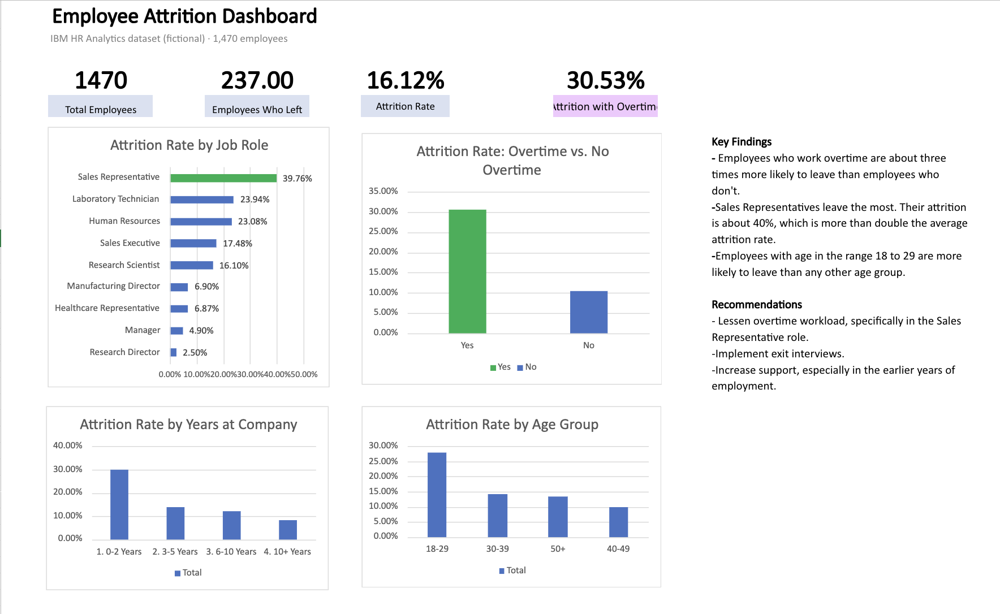

# Employee Attrition Analysis (Excel)

## Main Question
Which group of employees is leaving the most, and why?
## Data
For this project, I used an IBM HR Analytics Employee dataset from Kaggle: 1,470 employees, 35 attributes.  
[IBM HR Analytics Employee Attrition & Performance](https://www.kaggle.com/datasets/pavansubhasht/ibm-hr-analytics-attrition-dataset)  
**NOTE**: This dataset is a **fictional** dataset that was created by IBM for practice purposes.
## Process
1. **Cleaning:** Checked for blanks and duplicate employee IDs (none found);
   removed 3 constant columns (EmployeeCount, Over18, StandardHours).
2. **Feature creation:** Added an attrition flag (1/0) and grouped age,
   income, and tenure into bands.
3. **Analysis:** Calculated attrition rates with AVERAGEIFS and PivotTables
   across department, job role, overtime, age, income, tenure, and satisfaction.
4. **Dashboard:** KPI cards and charts highlighting the highest-risk groups.
## Key Finding
- Average attrition: **16.1%** (237 of 1,470)
- Sales Representatives: **39.76%**, the highest attrition rate of any role
- The attrition rate for employees with overtime (**30%**) is three times higher than the attrition rate for employees without overtime (**10%**).
## Recommendations
- Lessen overtime workload, specifically in the Sales Representative role.
- Implement exit interviews.
- Increase support, especially in the earlier years of employment.
## Limitations
These findings only show associations, not causes for attrition. Dataset is fictional.
## Tools
Excel (structured tables, IFS, AVERAGEIFS, PivotTables, charts)
